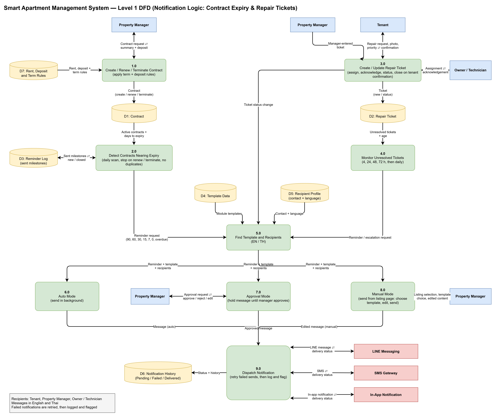

# Smart Apartment Management System — Level 1 DFD

**Scope:** Notification Logic for Contract Expiry & Repair Tickets

---

## 1. Diagram (Mermaid)

> Note: "Property Manager" appears several times in the original diagram (as a repeated external entity) to avoid crossing lines. It is the same entity.

---

## 2. External Entities

| Entity | Role |
|---|---|
| Property Manager | Manages contracts, enters tickets, approves messages (Approval Mode), and composes/sends messages (Manual Mode) |
| Tenant | Submits repair requests (with photo and priority), receives confirmations, confirms ticket closure |
| Owner / Technician | Receives repair assignments and sends acknowledgements |
| LINE Messaging | External channel for LINE messages and delivery status |
| SMS Gateway | External channel for SMS messages and delivery status |
| In-App Notification | In-app channel for notifications and delivery status |

---

## 3. Processes

| ID | Process | Description |
|---|---|---|
| 1.0 | Create / Renew / Terminate Contract | Applies term and deposit rules; stores the contract in D1 |
| 2.0 | Detect Contracts Nearing Expiry | Daily scan; stops on renew / terminate; prevents duplicate reminders using D3 |
| 3.0 | Create / Update Repair Ticket | Assign, acknowledge, update status, close on tenant confirmation |
| 4.0 | Monitor Unresolved Tickets | Escalation checks at 4, 24, 48, 72 h, then daily |
| 5.0 | Find Template and Recipients | Selects the template and recipients, in English or Thai |
| 6.0 | Auto Mode | Sends the message in the background |
| 7.0 | Approval Mode | Holds the message until the manager approves |
| 8.0 | Manual Mode | Manager chooses template, edits, and sends from the listing page |
| 9.0 | Dispatch Notification | Sends via LINE / SMS / In-App; retries failed sends, then logs and flags |

---

## 4. Data Stores

| ID | Name | Contents |
|---|---|---|
| D1 | Contract | Contract records (created / renewed / terminated) |
| D2 | Repair Ticket | Repair tickets and their status |
| D3 | Reminder Log | Sent reminder milestones (prevents duplicates) |
| D4 | Template Data | Message templates per module |
| D5 | Recipient Profile | Contact details and language preference |
| D6 | Notification History | Pending / Failed / Delivered status history |
| D7 | Rent, Deposit and Term Rules | Rules applied when creating or renewing contracts |

---

## 5. Data Flows

### 5.1 Contract Expiry

| # | From | To | Data |
|---|---|---|---|
| 1 | Property Manager ⇄ | 1.0 | Contract request ⇄ summary + deposit |
| 2 | D7 | 1.0 | Rent, deposit + term rules |
| 3 | 1.0 | D1 | Contract (create / renew / terminate) |
| 4 | D1 | 2.0 | Active contracts + days to expiry |
| 5 | D3 ⇄ | 2.0 | Sent milestones ⇄ new / closed |
| 6 | 2.0 | 5.0 | Reminder request (90, 60, 30, 15, 7, 0, overdue) |

### 5.2 Repair Tickets

| # | From | To | Data |
|---|---|---|---|
| 7 | Property Manager | 3.0 | Manager-entered ticket |
| 8 | Tenant ⇄ | 3.0 | Repair request, photo, priority ⇄ confirmation |
| 9 | Owner / Technician ⇄ | 3.0 | Assignment ⇄ acknowledgement |
| 10 | 3.0 | D2 | Ticket (new / status) |
| 11 | D2 | 4.0 | Unresolved tickets + age |
| 12 | 3.0 | 5.0 | Ticket status change |
| 13 | 4.0 | 5.0 | Reminder / escalation request |

### 5.3 Template, Recipient, and Mode Selection

| # | From | To | Data |
|---|---|---|---|
| 14 | D4 | 5.0 | Module templates |
| 15 | D5 | 5.0 | Contact + language |
| 16 | 5.0 | 6.0 | Reminder + template + recipients |
| 17 | 5.0 | 7.0 | Reminder + template + recipients |
| 18 | 5.0 | 8.0 | Reminder + template + recipients |
| 19 | Property Manager ⇄ | 7.0 | Approval request ⇄ approve / reject / edit |
| 20 | Property Manager ⇄ | 8.0 | Listing selection, template choice, edited content |

### 5.4 Dispatch

| # | From | To | Data |
|---|---|---|---|
| 21 | 6.0 | 9.0 | Message (auto) |
| 22 | 7.0 | 9.0 | Approved message |
| 23 | 8.0 | 9.0 | Edited message (manual) |
| 24 | 9.0 ⇄ | LINE Messaging | LINE message ⇄ delivery status |
| 25 | 9.0 ⇄ | SMS Gateway | SMS ⇄ delivery status |
| 26 | 9.0 ⇄ | In-App Notification | In-app notification ⇄ delivery status |
| 27 | 9.0 | D6 | Status + history |

---

## 6. Business Rules (from diagram notes)

- **Recipients:** Tenant, Property Manager, Owner / Technician
- **Languages:** Messages are sent in English and Thai
- **Failure handling:** Failed notifications are retried, then logged and flagged
- **Contract reminder milestones:** 90, 60, 30, 15, 7, 0 days, and overdue; the daily scan stops on renew / terminate and avoids duplicates
- **Ticket escalation schedule:** 4 h, 24 h, 48 h, 72 h, then daily
- **Ticket closure:** Tickets close on tenant confirmation
